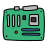

  
  
  

  # Creative Code Sandbox
  *Small, fun, experimental projects I build for myself.*

---

##  &nbsp; About This Space

Welcome to my digital playground! This repository is a curated collection of small projects I build for fun and for learning. Each one is broken down into digestible pieces so **anyone can follow along**.

Whether you're here to learn, get inspired, or just poke around, you're in the right place.

---

##  &nbsp; Featured Projects

| | Project | Description |
|:---:|:---|:---|
|  | **[`Posman`](https://posmans.vercel.app/)** | Share files and text directly between devices. No login, no sign-up. Connect with a 6-digit code or QR code, and everything travels peer-to-peer over WebRTC, so nothing is stored on a server. |

---

##  &nbsp; Tech I Play With

---

##  &nbsp; Privacy First

I like building tools that respect people: no accounts, no tracking, no data hoarding.

---

##  &nbsp; Let's Connect

   
  
  
  
    
  waynciman@gmail.com

